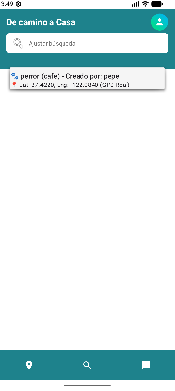
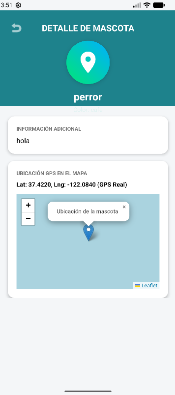
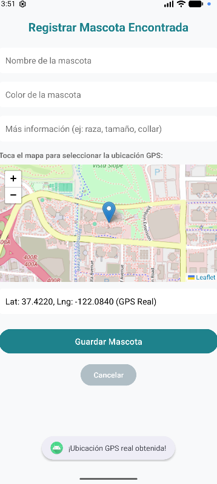

<p align="center">
  
</p>

#  De camino a Casa

<p align="center">
  <b>Una app colaborativa para reportar y ayudar a encontrar mascotas perdidas.</b>
</p>

<p align="center">
  
  
  
  
</p>

---

##  Acerca del Proyecto

**De camino a Casa** es una aplicación Android desarrollada para ayudar a dueños de mascotas, Su objetivo principal es ofrecer una ayuda rápida y directa para crear alertas de animales perdidos, permitiendo compartir ubicación, detalles físicos, descripciones de contacto y un feed de avisos en tiempo real mediante el uso seguro de permisos de sistema a nivel de ejecución.

---

##  Capturas de pantalla

   | Pantalla Principal  | detalle de mascota | registro de mascota |
<p align="center">
  
  
  
</p>

---

##  Características Principales

* **Feed de Alertas Dinámico:** Visualiza en tiempo real las publicaciones recientes de mascotas perdidas o avistamientos cercanos.
* **Sistema de Reportes Ágil:** Permite registrar un caso ingresando fotos, descripción, última ubicación vista y datos de contacto.
* **Gestión de Permisos en Tiempo Real:** Solicita de manera segura los permisos de ubicación y almacenamiento requeridos por el sistema Android.
* **UI Moderna:** Desarrollada con Jetpack Compose y adaptada a las guías visuales de Material Design 3.
* **Arquitectura Limpia:** Estructurado bajo el patrón **MVVM** modular para garantizar escalabilidad, separación de incumbencias y testeabilidad.
* **Asincronismo Eficiente:** Uso intensivo de Corrutinas de Kotlin y StateFlow para el manejo reactivo de estados.

---

## Stack Tecnológico y Herramientas

* **Lenguaje:** [Kotlin](https://kotlinlang.org/)
* **Interfaz de Usuario:** Jetpack Compose, Material Design 3, Navigation Compose
* **Arquitectura:** Model-View-ViewModel (MVVM), StateFlow, Clean Architecture Layers
* **Inyección de Dependencias:** [Hilt](https://dagger.dev/hilt/)
* **Asincronismo:** Kotlin Coroutines & Flow
* **Persistencia Local:** Room Database / DataStore *(según aplique)*
* **Red / API:** Retrofit / Ktor Client con OkHttp
* **Pruebas (Testing):** JUnit, MockK, Turbine, Espresso, Compose Testing
* **Calidad de Código:** Detekt, Ktlint

---

##  Estructura del Proyecto

```text
app/
├── src/main/
    ├── java/com/example/decaminoacasa/
    │   ├── DB/                  # Clases de gestión y conexión a Base de Datos
    │   ├── AdminActivity.java   # Panel o vista de administración
    │   ├── AgregarMascotaActivity.java # Formulario de registro de mascotas
    │   ├── DetalleMascotaActivity.java # Vista detallada de una mascota
    │   ├── Inicio_De_Sesion.java  # Control de autenticación / Login
    │   ├── MainActivity.java    # Actividad principal / Feed de avisos
    │   ├── Mascota.java         # Modelo de datos (Entidad)
    │   ├── MascotaRepository.java # Repositorio de gestión de datos
    │   ├── Pantalla_inicio.java # Pantalla de bienvenida / Home
    │   └── Perfil_Usuario.java  # Gestión de perfil del usuario
    └── res/
        ├── layout/              # Diseños de interfaz en XML (Activities y Diálogos)
        ├── drawable/            # Recursos gráficos, vectores e imágenes
        └── mipmap-*/            # Iconos de la aplicación adaptativos
